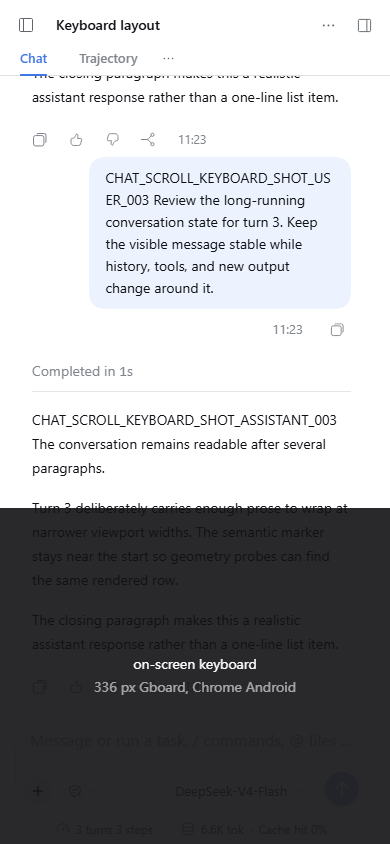
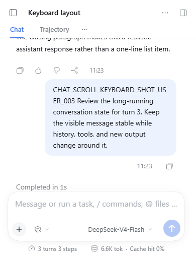

## What happens today

On Android Chrome, tapping the composer to type puts the draft, the control row, and Send behind the on-screen keyboard; closing the keyboard is the only way to see what was typed.

| Before — keyboard open (simulated band) | With the declaration — same 336 px keyboard |
|---|---|
|  |  |

The two screenshots are the same conversation at the same scroll position. In the second one the layout viewport is the 508 px above the keyboard: the composer sits on that floor, and every transcript row is still at the height it had before.

## Why it happens

The Web GUI sizes itself to the **layout viewport** (`html`, `body`, and `#root` are `height: 100%`) and docks the composer as a sticky seat at the floor of the conversation column (`packages/client/ui-conversation/src/client/skeleton/ConversationRoot.module.css`). That floor only clears an on-screen keyboard when the browser shrinks the layout viewport for it.

Since Chrome 108, that is no longer Android's default: Chrome shrinks only the **visual** viewport (`resizes-visual`) and leaves the layout viewport at full height, so bottom-anchored and `position: fixed` content stays behind the keyboard, and the document has no overflow a pan could reveal it with. Firefox on Android and Android WebView still resize the layout viewport, so the defect is specific to Chromium on Android, where the default changed ([Chrome's viewport resize behavior post](https://developer.chrome.com/blog/viewport-resize-behavior)).

## Proposal

Declare the documented opt-out in `apps/web/index.html`:

```html
<meta name="viewport" content="width=device-width, initial-scale=1, interactive-widget=resizes-content" />
```

With `resizes-content`, the layout viewport shrinks when the keyboard opens: the shell, the AppFrame columns, the conversation scrollport, and the composer's sticky floor all end above the keyboard, and fixed surfaces (sidebar drawer, menus, dialogs) are laid out inside the shortened viewport.

**The keyboard then moves the composer and nothing else.** Chat treats a scrollport that changed height while the composer's text field has focus as a keyboard transition (`packages/client/ui-chat/src/client/chat/use-chat-viewport.ts`): the viewport restores the transcript's acknowledged scroll position — clamped to the shortened range — and `ChatReading.onResize` skips the tail follow it applies to an ordinary layout resize. The shorter port paints the same content at the same screen offset, so the reader keeps their place while the composer rises. Candidate-bar changes while the keyboard is up hold the same way; content growth is not a keyboard change, so streamed output still follows the tail.

Engines that ignore the key are pixel-identical to today: WebKit, desktop, and Android WebView.

## Verification

- `apps/web/tests/pwa-manifest.e2e.ts` pins the declaration in the built `dist/index.html`.
- `apps/web/tests/mobile-keyboard.e2e.ts`: at 390×508 (an 844 px phone minus a 336 px Gboard) the composer card stays fully inside the viewport, the shell adds no page-level overflow, and `window.scrollY` stays 0. With a seeded transcript, a rendered row keeps its screen offset and `scrollTop` across the shrink, closing the keyboard moves nothing, and the same shrink without composer focus still lands a following reader at the tail.
- Chat unit tests: `chat-viewport.client.spec.ts` covers the transition and the hold — a keyboard shrink, a candidate-bar resize, content growth, and focus loss; `fold-follow.client.spec.ts` covers the reading policy.
- `pnpm run build` (all 10 gates), `pnpm run lint`, `pnpm run test:gui`, and the Agent Note gates pass locally.
- **Not verified on a physical Android device** — no headless engine raises a real keyboard. That is the one check worth doing before merging.

## Trade-off worth a look

Holding the transcript means the rows under the composer stay behind the keyboard until the reader scrolls or new output follows the tail. The alternative — following the tail on every keyboard resize — scrolls the transcript by the keyboard's height, so the text a reader is looking at jumps away the moment they tap the draft. I picked the still transcript; if maintainers prefer the tail pinned, it is one condition in `ChatReading.onResize` to flip.

## Remaining gap: WebKit

iOS Safari (and every iOS browser, and in-app WKWebView) never resizes the layout viewport for the keyboard and ignores `interactive-widget`, so the composer has the same problem there. Only a `visualViewport` follower would fix it: publish `visualViewport.height`/`offsetTop` and pin the app mount to that box while a keyboard is open.

I left it out of this patch on purpose:

- it changes the layout height under a keyboard, which `apps/web/tests/sidebar-drawer.e2e.ts` currently pins for a simulated keyboard (drawer and dialog geometry), so it needs its own decision and test updates;
- the mount would move while Safari pans the visual viewport, and body-portalled overlays would need to share that frame of reference.

If the Android fix is acceptable, I can follow up with the WebKit follower and the test changes it implies.

## Patch

- Branch: [`feat/mobile-keyboard-layout-viewport`](https://github.com/devycx/deepseek-harness/tree/feat/mobile-keyboard-layout-viewport)
- Diff: [`master...feat/mobile-keyboard-layout-viewport`](https://github.com/deepseek-ai/deepseek-harness/compare/master...devycx:deepseek-harness:feat/mobile-keyboard-layout-viewport)
- The viewport meta, its PWA expectation, the Chat keyboard transition (viewport + reading policy), two unit specs, the new e2e plus its two tsconfig registrations, and an Agent Note (`implemented/feature/2026-11-16-mobile-keyboard-layout-viewport.md`).

Filed as a Discussion because [CONTRIBUTING](https://github.com/deepseek-ai/deepseek-harness/blob/master/CONTRIBUTING.md) says external pull requests are not accepted yet.

## 中文摘要

- 现象：Android Chrome 输入时，输入框（草稿、控制行、发送按钮）被系统键盘盖住，关闭键盘才能看见。
- 原因：Chrome 108 起 Android 默认只缩「视觉视口」（`resizes-visual`），布局视口保持原高度；本项目按布局视口布局，输入框 sticky 在会话列底部，于是落在键盘之后，且页面没有可滚动溢出。
- 方案：`apps/web/index.html` 的 viewport meta 增加 `interactive-widget=resizes-content`，让 Android Chromium 恢复「键盘缩小布局视口」，输入框的 sticky 底部自然停在键盘上沿之上。
- 只动输入框，不动对话：Chat 把「输入框文字区域持有焦点时滚动区高度变化」识别为键盘切换，恢复对话已确认的滚动位置而不是贴底跟随；缩短后的滚动区在同样的屏幕位置画同样的内容，读者正在看的那一行不会跳走。候选栏引起的二次高度变化同样处理，内容增长仍照常跟随底部。
- 验证：390×508（844 − 336 键盘）下输入框整卡可见、页面无溢出；预置对话在缩放前后保持同样的屏幕偏移与 `scrollTop`，失焦后同样的缩放仍会贴底；另有 viewport / reading 两处单测。尚未在真机验证。
- 遗留：WebKit（iOS Safari / WKWebView）忽略该键，需要另一套 `visualViewport` 跟随方案，可作为后续改动。
